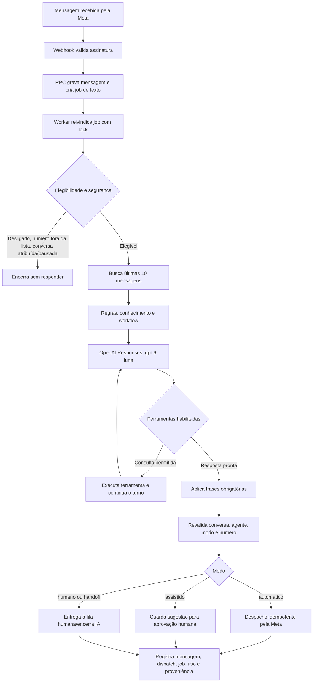

# Auditoria do atendente de IA da Central de Atendimento

**Data:** 11/11/2026

**Escopo:** implementação do atendente de IA para WhatsApp na Central de Atendimento do ERP MoranteHub.
**Base da auditoria:** código e documentação presentes neste checkout e suítes Vitest direcionadas.

> Auditoria estática do código, com testes Vitest e leituras somente de metadados/permissões do Supabase e da Vercel. Não li conteúdo de `settings`, não alterei banco ou configuração, não disparei a recuperação remota e não enviei mensagens reais à Meta/OpenAI. Agendadores externos à Vercel e o estado de ativação do agente não foram consultados.

## Resumo executivo

O atendente é um fluxo de WhatsApp executado no backend do ERP. Ele está **desligado por padrão**. O ícone do agente no painel esquerdo abre a conversa de teste, onde um administrador pode ligar o atendimento manualmente. Salvar instruções, ferramentas ou números de teste não liga o agente. Para permitir a ativação, deve haver pelo menos um número na lista de testes. Com o agente ligado e o modo `automatico`, esses números podem receber respostas reais via WhatsApp; `testMode: true` restringe a lista autorizada, mas não transforma o envio automático em simulação.

**Estado remoto consultado nesta auditoria:** `enabled=false`, `testMode=true` e zero números autorizados. Consultei somente esses indicadores, sem ler o prompt ou os telefones. Portanto, o agente está desligado no banco e nenhum telefone pode passar pela lista de teste neste momento.

O modelo efetivamente usado no fluxo auditado é **OpenAI `gpt-6-luna` pela Responses API**. Não encontrei chamada ou fallback para Gemini no caminho atual. Corrigi a documentação da integração, que descrevia Gemini como failover e Chat Completions.

Há controles relevantes de segurança e consistência: validação da assinatura do webhook, fila persistente para mensagens de texto, trava distribuída por conversa, controle de idempotência, revalidação das configurações antes do envio, limites de uso e encaminhamento humano em casos de incerteza ou envio ambíguo.

Os pontos que precisam de atenção são: a Vercel não tem Cron Jobs configurados para recuperar a fila; confirmar se há agendador externo; planejar uma recuperação em lotes limitados; e corrigir a leitura ampla do JSON global de configurações. Atualizei o mock integrado e agora os testes direcionados passam. O produto ainda não apresenta uma tela de auditoria por atendimento real.

## Fluxo geral

## Implementação por etapa

### 1. Controle e configuração na Central

- O hook `useWhatsAppAiAgentSwitch` carrega o estado confirmado remotamente e só permite alteração para administradores. Enquanto o estado remoto é desconhecido ou a atualização está em andamento, o controle fica bloqueado.
- O botão de ligar/desligar fica no cabeçalho da conversa de teste, acessada pelo ícone do agente no painel esquerdo. A operação usa `react-hook-form` com `zodResolver` e faz uma atualização condicional: o banco só confirma a troca se o valor anterior ainda for o esperado. Isso evita que uma aba antiga sobrescreva uma alteração feita em outra sessão.
- A conversa de teste usa as configurações salvas, inclusive uma lista de ferramentas vazia, e mantém o rascunho durante a troca de conversa na sessão. Ao selecionar novamente um cliente, o controlador encaminha a conversa ao carregador existente de histórico paginado; ao abrir o teste, a seleção do cliente é limpa. Não houve medição de chamadas ou egress para essa correção.
- A RPC `update_whatsapp_ai_agent_settings` separa a chave `enabled` das demais configurações. Editar prompt, ferramentas, modelo ou telefones preserva o estado atual; o valor só muda pela ação explícita do botão.
- Valores padrão encontrados: `enabled: false`, `testMode: true`, lista de telefones vazia, modo `automatico` e modelo `gpt-6-luna`. A ativação é impedida pela interface quando a lista de números de teste está vazia.
- O esquema compartilhado fixa `testMode` em `true`. A elegibilidade valida o telefone em toda mensagem; portanto, durante esta fase, o atendente não responde a qualquer cliente.

Arquivos principais: `erp/src/pages/App/CustomerSupport/hooks/useWhatsAppAiAgentSwitch.ts`, `components/NavigationRail.tsx`, `services/whatsappAiAgentSettings.ts`, `erp/src/pages/utils/settings/defaults.ts`, `shared-utils/whatsappAiAgentSchemas.ts` e migration `supabase/migrations/20261111040950_update_whatsapp_ai_agent_settings.sql`.

### 2. Recebimento e criação do trabalho

- `erp/api/whatsapp-webhook.ts` valida a assinatura HMAC da Meta antes de processar POST em produção. O segredo e a chave de serviço são usados no backend.
- A RPC `customer_support_receive_message_with_ai_job` grava a mensagem recebida de forma atômica e cria job somente para mensagem do tipo `text` com conteúdo não vazio. Imagens, áudios e outros tipos podem ser registrados, mas não são enviados ao modelo por este fluxo.
- O handler tenta processar o job imediatamente. Se essa tentativa excepcionalmente escapar com erro, registra o problema no log e deixa a recuperação para o fluxo durável.
- A fila guarda tentativas, etapa de execução, resposta preparada, despacho e lock token. A resposta é persistida antes do envio externo; se o resultado do envio à Meta ficar incerto, o sistema encaminha para conferência humana em vez de reenviar às cegas.

Arquivos principais: `erp/api/whatsapp-webhook.ts`, `erp/src/pages/utils/customerSupport/webhook/whatsappInboundMessageHandler.ts`, `whatsappAiAgent/durableAiJob.ts` e migration `supabase/migrations/20261111031003_whatsapp_ai_durable_jobs.sql`.

### 3. Elegibilidade e prevenção de resposta indevida

Antes de gerar resposta, o backend verifica que o agente está ligado, o modo não é exclusivamente humano, o número pertence à lista de testes e a conversa existe, não está arquivada, atribuída a uma pessoa, pausada ou marcada para atendimento humano. A trava distribuída no PostgreSQL evita turnos simultâneos da mesma conversa em instâncias diferentes.

Imediatamente antes do envio, o sistema consulta novamente conversa e configurações. Se alguém desligar o agente, mudar o modo, atribuir a conversa ou retirar o número autorizado enquanto o modelo está respondendo, a resposta gerada é descartada.

Arquivos principais: `orchestrator/turnEligibility.ts`, `security/distributedTurnLock.ts` e `dispatcher/preDispatchGuards.ts`.

### 4. Contexto, regras, conhecimento e modelo

- A busca do histórico limita-se às dez mensagens mais recentes da conversa e envia ao modelo as mensagens de atendimento formatadas, além da instrução principal.
- O pipeline acrescenta situação detectada, regras do atendimento, conteúdo relevante da base de conhecimento, workflow aplicável e declarações das ferramentas que estão habilitadas.
- Todos os turnos deste agente fixam o modelo em `gpt-6-luna`. A chamada é feita no servidor a `https://api.openai.com/v1/responses`, com até 2.048 tokens de saída e esforço de raciocínio `low`. A chave `OPENAI_API_KEY` não é lida no navegador.
- O runner repete uma vez respostas HTTP 502/503 antes de executar ferramentas, pois ainda não houve efeito externo. O loop de ferramenta permite continuar a conversa com o modelo. Não há fallback para outro provedor; após falha persistente, o job tenta novamente conforme a política da fila ou encaminha para uma pessoa.
- Depois da geração, o pipeline aplica frases mandatórias definidas pela regra de atendimento antes de despachar a resposta.

Arquivos principais: `orchestrator/historyFetcher.ts`, `orchestrator/turnContext.ts`, `orchestrator/turnExecutionPipeline.ts`, `runners/openAiTurnRunner.ts`, `whatsappAiModelRunner.ts`, engines de regra/workflow e `shared-utils/whatsappAiAgentDefaults/`.

### 5. Ferramentas disponíveis ao modelo

O catálogo declara ferramentas de busca de produto e detalhes, categorias/características, informações comerciais da loja, consulta de pedidos do próprio cliente, estimativa de frete/distância e encaminhamento para atendimento humano. A lista ativa é filtrada pelas ferramentas habilitadas na configuração. Não encontrei ferramenta do atendente WhatsApp para criar ou alterar pedido/venda.

Arquivos principais: `tools/declarations.ts`, `tools/toolRegistry.ts`, `tools/catalogTools.ts`, `tools/orderTools.ts`, `tools/freightTools.ts` e `tools/handoffService.ts`.

### 6. Modos de atendimento e envio

| Modo | Comportamento observado |
| --- | --- |
| `automatico` | Prepara despacho idempotente e envia texto ao cliente pela Meta; depois registra o resultado e a proveniência da resposta. |
| `assistido` | Guarda uma sugestão interna para aprovação do atendente, sem enviar pela API da Meta. |
| `humano` | Bloqueia a execução da IA. |

O encaminhamento silencioso não envia uma resposta improvisada ao cliente. Se o resultado da chamada à Meta for incerto, ou as tentativas de processamento acabarem, a fila registra a necessidade de conferência humana. O despacho registra status e identificador da mensagem da Meta, o que evita duplicar um envio já confirmado.

### 7. Quotas e registros de auditoria

Antes de chamadas reais, o runner reserva cota e registra tokens/uso por RPC. A aba de cotas mostra valores agregados (requisições, tokens, custo e limites) e restringe a consulta a administradores. Os limites de IA são compartilhados com outros módulos, não são um relatório exclusivo da Central.

O código mantém várias fontes técnicas de evidência:

- `api_usage_logs`: uso e contabilização do modelo;
- `whatsapp_ai_agent_turns`: estado do turno, trava, modelo e metadados;
- `whatsapp_ai_dispatches`: idempotência e resultado de envio;
- `whatsapp_ai_message_jobs`: tentativas e estado da fila;
- `whatsapp_messages.raw_payload`: proveniência da resposta, incluindo ferramentas, situação, frases aplicadas, artigos/workflow, modelo e modo.

As migrations recentes revogam acesso direto de `anon` e `authenticated` às tabelas internas de turnos e despachos, deixando o acesso técnico no `service_role`. A tela de teste do agente oferece diagnóstico detalhado por simulação (tempo, ferramentas, regras/conhecimento), mas não é uma tela de auditoria dos atendimentos reais. Não localizei uma consulta administrativa por conversa/turno que reúna esses registros em um relatório legível.

## Achados da auditoria

### Recuperação da fila — falta agendamento na Vercel

**Confirmado: a consulta `vercel crons list --format json` retornou `crons: []` para o projeto `morantehub`.** Também não há `crons` no `erp/vercel.json`. O endpoint `GET /api/whatsapp-webhook?operation=ai-recovery` exige `CRON_SECRET` e processa um job por chamada. O webhook cria o job e tenta processá-lo na hora; falha na tentativa imediata é registrada em log sem entrar em `result.errors`, então o POST pode responder sucesso enquanto o job aguarda recuperação. Não consultei um eventual agendador externo.

**Capacidade:** 1 job por chamada significa que 100 jobs acumulados com um agendamento por minuto levam pelo menos 100 minutos para drenar, sem contar novas mensagens. Esta é uma projeção aritmética, não uma medição de carga.

**Recomendação:** localizar ou criar um agendamento e avaliar lote limitado por quantidade e tempo restante da função, com concorrência baixa entre conversas e mantendo a trava por conversa. O endpoint tem limite Vercel de 60 segundos. Não iniciei o endpoint remoto, porque ele poderia processar trabalho real conforme o estado remoto do agente.

### Corrigido nesta etapa

O documento `docs/integracoes/central-de-atendimento-openai-gpt6-luna-2026-11-09.md` afirmava Gemini como failover, Chat Completions e validação operacional de produção. O código usa OpenAI `gpt-6-luna` em `v1/responses`, com retry transitório limitado e sem failover para outro provedor. Reescrevi o documento para refletir o código; o estado publicado e qualquer chamada real continuam sem confirmação.

Também corrigi o mock do cenário integrado, adicionando RPCs de trava/quota/despacho e a cadeia de consulta das variações do catálogo. A causa era fixture incompleta; não alterei o comportamento de produção.

### Achado de segurança confirmado — leitura de configurações

Na leitura somente de metadados do projeto Supabase operacional `hkoxhourxwlddgsfdgws`, `information_schema.role_table_grants` confirmou `SELECT` para o papel `authenticated` em `public.settings`, e `pg_policies` retornou a policy `Authenticated can read settings` com `USING (true)`. `anon` não tem `SELECT`. Como o cliente carrega `settings.data` integralmente e o objeto inclui `systemPrompt` e `testPhoneNumbers`, qualquer sessão autenticada com acesso normal à API pode ler esses campos, não apenas administradores. A policy de escrita continua separada, destinada a administradores.

Não consultei os valores da linha nem encontrei evidência de chave OpenAI nesse JSON; a chave é lida no servidor. O histórico de segurança de configuração do projeto confirma que esta leitura ampla é arquitetural e também serve outros módulos, então remover o `SELECT` sem migrar os consumidores pode quebrar o ERP.

**Recomendação:** planejar uma projeção seletiva e autorização para as configurações internas do agente, preservando os campos realmente públicos usados pelos outros consumidores. Não apliquei migration: precisa de inventário transversal e compatibilidade do JSON global.

### Capacidade ausente, caso o objetivo seja auditoria operacional

Há logs estruturados e diagnósticos de simulação, porém não há no painel uma tela para localizar um atendimento real e ver a sequência de entrada, contexto, ferramentas chamadas, modelo, resposta, despacho, tentativas, custo e encaminhamento. A aba atual de cotas é agregada e compartilhada com outros módulos. Para análise operacional, seria necessário um relatório administrativo que leia os registros existentes por RPC autorizada e permita filtrar por conversa, período e estado, sem expor tabelas internas ao cliente.

## Três pontos adicionais avaliados

### Fila em lote

O limite de um job por chamada confirma a preocupação com backlog. Lote com limite de quantidade e de tempo restante reduz o número de invocações para recuperar uma fila, mas precisa manter idempotência, lock por conversa, handoff em estado incerto e um teto que respeite os 60 segundos da função. Concorrência deve ocorrer entre conversas independentes, nunca entre jobs da mesma conversa sem passar pela trava. Não implementei o lote nem medi capacidade.

### Contexto longo

`historyFetcher.ts` busca as dez mensagens mais recentes. Esse recorte pode deixar de incluir dados comerciais informados mais cedo. Um resumo persistente é uma opção, mas exigiria definir atualização, tamanho, vínculo com a conversa, proteção contra prompt injection, invalidação após correção/remoção de mensagens e quais dados podem ser enviados ao provedor. Não há resumo persistente implementado neste caminho.

### Qualidade semântica

Os 81 testes aprovados validam ramificações e contratos com respostas de modelo simuladas. Não medem se o modelo escolhe produto correto ou segue regras com mensagens ambíguas. A avaliação próxima deveria usar cenários de teste controlados e critérios observáveis: ferramenta/argumentos esperados, não inventar produto/preço, não conceder desconto, comportamento em erro de ferramenta, respeito à quota, handoff explícito, não responder a número não autorizado e não duplicar envio incerto. A simulação administrativa disponível pode ajudar, mas não foi rodada contra a OpenAI nesta etapa.

| Cenário da avaliação | Evidência esperada |
| --- | --- |
| Busca exata e busca ambígua de produto | Ferramenta e argumentos corretos; pede esclarecimento quando não há correspondência confiável. |
| Produto, preço ou condição inexistente | Não inventa item, preço, estoque ou condição comercial. |
| Pedido de desconto fora das regras | Explica os limites e não concede nem registra desconto. |
| Ferramenta indisponível ou com erro | Não apresenta resultado falso; oferece encaminhamento humano. |
| Cliente pede pessoa | Marca o handoff e interrompe respostas automáticas posteriores. |
| Agente desligado, conversa atribuída ou telefone não autorizado | Não chama OpenAI nem Meta. |
| Timeout/resultado incerto da Meta | Não reenvia automaticamente; deixa o caso para conferência. |

## Testes direcionados executados

Foram executadas suítes Vitest de ativação manual, serviço de configuração, integração do atendente, concorrência/travas, cotas, pipeline, despacho automático, runner OpenAI, endpoint de recuperação, fila durável e ferramentas de catálogo/pedidos.

- **81 testes passaram em 16 arquivos.**
- A suíte `whatsappAiAgentService.test.ts` passou **20/20** após completar o mock das RPCs e da busca de variações.
- A suíte do endpoint de recuperação e testes da fila passaram **9/9** em execução direcionada.
- Na alteração posterior da navegação do chat de teste, outra bateria passou **58/58 em 10 arquivos**, cobrindo troca de conversa, configurações salvas, validação do chat e controle manual. As baterias têm testes em comum e seus totais não devem ser somados.
- Arquivos cobertos: `useWhatsAppAiAgentSwitch.test.tsx`, `whatsappAiAgentService.test.ts`, `whatsappAiAgentIntegrationE2E.test.ts`, `whatsappAiAgentConcurrency.test.ts`, `aiUsageLimitsAndQuotas.test.ts`, `turnExecutionPipeline.test.ts`, `dispatchAutomaticMode.test.ts`, `openAiTurnRunner.test.ts`, `whatsappAiAgentSettings.test.ts`, `AiAgentTabQuotas.test.tsx`, `durableAiJob.test.ts`, `durableAiJob.flow.test.ts`, `customerSupportRecoveryEndpoint.test.ts`, `handoffService.test.ts`, `catalogTools.test.ts` e `orderTools.test.ts`.
- Não foi feito build completo nesta auditoria. Não foram usados Supabase local, banco local, chamadas reais ao modelo ou envio real de WhatsApp.

## Fora do escopo / pendente de confirmação

- Conteúdo remoto do prompt, das ferramentas e das regras; os telefones em si não foram consultados. Só foi lida a quantidade de números autorizados.
- Agendador externo que possa chamar `ai-recovery` e sua capacidade de processar backlog.
- Versão e configuração efetivamente servidas pelo deployment; a leitura de Cron Jobs confirmou que a Vercel não tem job registrado para esse projeto.
- Funcionamento real ponta a ponta com webhook assinado da Meta, credenciais atuais, OpenAI e envio de WhatsApp.
- Política de retenção e tratamento de conteúdo pela OpenAI; esta auditoria apenas identificou os dados que o código envia.

## Parecer

O desenho atual prioriza ativação manual, restrição a números de teste, controle de concorrência, revalidação antes do envio e prevenção de duplicidade diante de resultado incerto. **A configuração local permanece desligada por padrão; esta auditoria não ligou o atendimento automático.** A Vercel não tem Cron Job para recuperação e o acesso autenticado à linha global de configurações está confirmado.

Antes de depender do fluxo em operação, localize ou configure o agendador, planeje processamento limitado em lote e trate a projeção autorizada das configurações. A documentação e a suíte integrada já foram corrigidas localmente. A qualidade semântica e um relatório de atendimentos reais ainda exigem trabalho separado. Nenhuma ativação automática foi feita.
