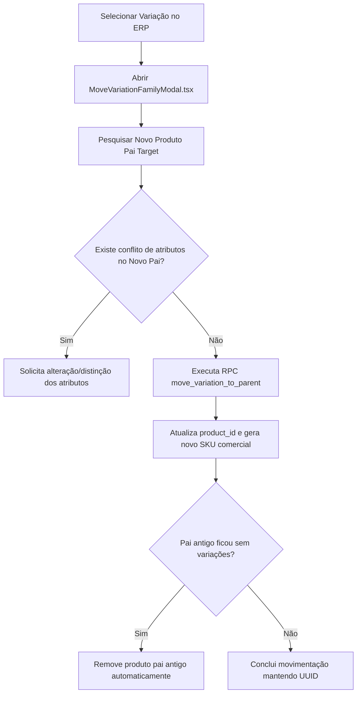

# Operações Avançadas: Mover Pai e Mesclar Produtos — Morante Hub

Este documento descreve a transferência de uma variação para outro produto pai, a mesclagem de variações e a mesclagem de produtos duplicados no Morante Hub.

---

## 🔀 Operação 1: Mover Variação para Outro Pai (`moveVariationToFamily`)

### Objetivo
Permite reatribuir o produto pai (`product_id`) de uma variação sem alterar seu `UUID`, preservando integralmente o histórico de vendas, estoque e movimentações.



---

## 🔀 Operação 2: Mesclar Variações (`mergeVariationIntoCanonical`)

### Objetivo
Unificar cadastros duplicados de uma mesma variação. A variação não-canônica (origem) repassa suas informações e associações para a variação canônica (destino).

```mermaid
flowchart TD
    A[Selecionar Variação Origem] --> B[Abrir MergeVariationModal.tsx]
    B --> C[Pesquisar Variação Canônica Destino]
    C --> D[Executar RPC merge_product_variation_into_canonical]
    D --> E[Aponta origem para a canônica via merged_to_variation_id]
    E --> F[Mescla associações de fornecedores entre os produtos pais]

### Limites da mesclagem de variações

A RPC `merge_product_variation_into_canonical` registra o vínculo entre as variações e transfere associações de fornecedores do produto pai. Ela não soma o saldo, não altera referências de venda ou movimentação e não reescreve compras e snapshots. Para mesclar produtos pais duplicados com seus saldos e referências operacionais, use a operação seguinte.

---

## 🔀 Operação 3: Mesclar Produto Duplicado

### Objetivo

Unificar um cadastro pai duplicado em outro produto pai que permanecerá como canônico. A ação aparece para perfis com permissão de excluir produtos e exige que os dois cadastros sejam compatíveis, tenham variações com atributos correspondentes e que o destino esteja ativo.

```mermaid
flowchart TD
    A[Selecionar produto pai duplicado] --> B[Abrir Mesclar produto duplicado]
    B --> C[Pesquisar e selecionar o produto canônico]
    C --> D[RPC valida compatibilidade e referências]
    D --> E[Soma saldo por variação equivalente]
    D --> F[Redireciona vendas e movimentações normalizadas]
    D --> G[Transfere imagens, categorias, analytics e fornecedores]
    E --> H[Envia origem à Lixeira por 30 dias]
    F --> H
    G --> H
    H --> I[Sincroniza exclusão e atualização com a Meta]
```

### Preservação e bloqueios

- O saldo do pai é recalculado pela soma das variações correspondentes; o saldo das variações de origem fica zerado e elas apontam para suas equivalentes canônicas.
- Vendas e movimentações normalizadas passam a apontar para o produto e a variação canônicos. Descrições, `item_snapshot`, snapshots do pedido e documentos fiscais permanecem como foram registrados.
- Imagens, categorias e analytics são associados ao produto canônico. Associações de fornecedor são reunidas pela rotina vigente de mesclagem de variações.
- A origem fica inativa, oculta e marcada como excluída (`deleted = true`), com recuperação pela Lixeira durante 30 dias. Não há exclusão física nesta operação.
- A operação é recusada sem alterações quando encontra recebimentos, compras, vínculos fiscais, composições, etiquetas ou outras referências que precisam de tratamento próprio.
- Depois da sincronização `items_batch`, confirme no catálogo da Meta que os `retailer_id`/SKUs da origem foram removidos e que os do destino continuam presentes.
```

---

## 🔗 Mapeamento em Código e Testes

- **Serviço de Variações**: `erp/src/pages/utils/productService/productVariationActionsService.ts`
- **Modal Mover Pai**: `erp/src/pages/App/Products/ProductList/modals/MoveVariationFamilyModal.tsx`
- **Modal Mesclar Variação**: `erp/src/pages/App/Products/ProductList/modals/MergeVariationModal.tsx`
- **Modal Mesclar Produto Duplicado**: `erp/src/pages/App/Products/ProductList/modals/MergeDuplicateProductModal.tsx`
- **Serviço e RPC de Mesclagem de Produtos**: `erp/src/pages/utils/productService/productDuplicateMergeService.ts` e `supabase/migrations/20261029182631_merge_duplicate_products.sql`
